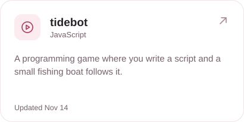
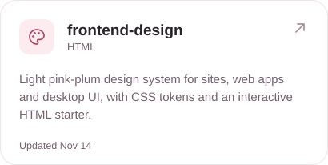
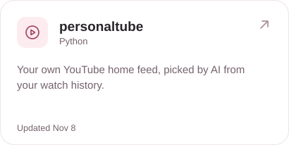
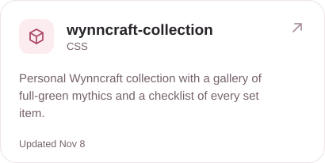
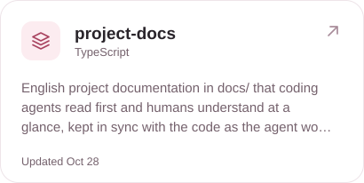

### Latest

<!-- latest:start -->

  <a href="https://github.com/byrodi/easyappoint.online"><picture><source media="(prefers-color-scheme: dark)" srcset="./assets/cards/easyappoint.online-dark.svg"></picture></a>
  <a href="https://github.com/byrodi/tidebot"><picture><source media="(prefers-color-scheme: dark)" srcset="./assets/cards/tidebot-dark.svg"></picture></a>
  <a href="https://github.com/byrodi/frontend-design"><picture><source media="(prefers-color-scheme: dark)" srcset="./assets/cards/frontend-design-dark.svg"></picture></a>
  <a href="https://github.com/byrodi/personaltube"><picture><source media="(prefers-color-scheme: dark)" srcset="./assets/cards/personaltube-dark.svg"></picture></a>
  <a href="https://github.com/byrodi/wynncraft-collection"><picture><source media="(prefers-color-scheme: dark)" srcset="./assets/cards/wynncraft-collection-dark.svg"></picture></a>
  <a href="https://github.com/byrodi/project-docs"><picture><source media="(prefers-color-scheme: dark)" srcset="./assets/cards/project-docs-dark.svg"></picture></a>

<!-- latest:end -->

### Last 30 days

<picture><source media="(prefers-color-scheme: dark)" srcset="./assets/activity-dark.svg"></picture>

### More

<!-- more:start -->
- Products: [proxyrun-releases](https://github.com/byrodi/proxyrun-releases)
- Agent skills: [chrome-devtools](https://github.com/byrodi/chrome-devtools), [humanizer](https://github.com/byrodi/humanizer), [skills](https://github.com/byrodi/skills), [github-publish](https://github.com/byrodi/github-publish), [ui-gallery](https://github.com/byrodi/ui-gallery)
- Code style: [java-code-style](https://github.com/byrodi/java-code-style), [typescript-code-style](https://github.com/byrodi/typescript-code-style)
- Wynncraft: [wynncard](https://github.com/byrodi/wynncard), [wynnhermes](https://github.com/byrodi/wynnhermes)
- Other projects: [sketchdraw](https://github.com/byrodi/sketchdraw)
- Forks: [winget-pkgs](https://github.com/byrodi/winget-pkgs), [Wynntils](https://github.com/byrodi/Wynntils)
<!-- more:end -->

  <picture><source media="(prefers-color-scheme: dark)" srcset="./assets/mark-dark.svg"></picture>

