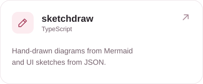
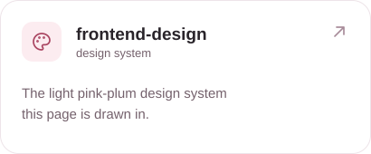

<picture>
  <source media="(prefers-reduced-motion: reduce)" srcset="./assets/banner.png">
  
</picture>

### Things I build

  <a href="https://github.com/byrodi/skills"><picture><source media="(prefers-color-scheme: dark)" srcset="./assets/cards/skills-dark.svg"></picture></a>
  <a href="https://github.com/byrodi/sketchdraw"><picture><source media="(prefers-color-scheme: dark)" srcset="./assets/cards/sketchdraw-dark.svg"></picture></a>
  <a href="https://github.com/byrodi/frontend-design"><picture><source media="(prefers-color-scheme: dark)" srcset="./assets/cards/frontend-design-dark.svg"></picture></a>
  <a href="https://github.com/byrodi/proxyrun-releases"><picture><source media="(prefers-color-scheme: dark)" srcset="./assets/cards/proxyrun-dark.svg"></picture></a>

### More

- Agent skills: [humanizer](https://github.com/byrodi/humanizer), [project-docs](https://github.com/byrodi/project-docs), [github-publish](https://github.com/byrodi/github-publish), [chrome-devtools](https://github.com/byrodi/chrome-devtools), [ui-gallery](https://github.com/byrodi/ui-gallery)
- Code style: [java](https://github.com/byrodi/java-code-style), [typescript](https://github.com/byrodi/typescript-code-style)
- Wynncraft: [wynncard](https://github.com/byrodi/wynncard), [wynnhermes](https://github.com/byrodi/wynnhermes), [wynncraft-collection](https://github.com/byrodi/wynncraft-collection)

  <picture><source media="(prefers-color-scheme: dark)" srcset="./assets/mark-dark.svg"></picture>

