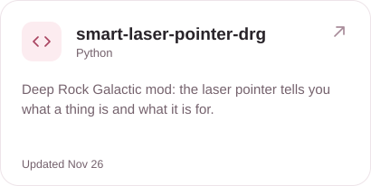
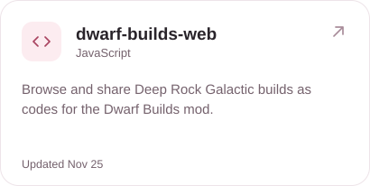
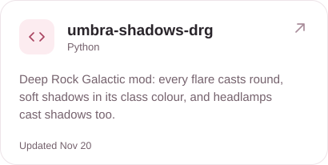
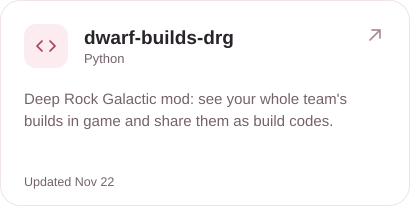
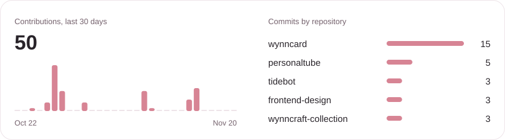

### Latest

<!-- latest:start -->

  <a href="https://github.com/byrodi/smart-laser-pointer-drg"><picture><source media="(prefers-color-scheme: dark)" srcset="./assets/cards/smart-laser-pointer-drg-dark.svg"></picture></a>
  <a href="https://github.com/byrodi/dwarf-builds-web"><picture><source media="(prefers-color-scheme: dark)" srcset="./assets/cards/dwarf-builds-web-dark.svg"></picture></a>
  <a href="https://github.com/byrodi/umbra-shadows-drg"><picture><source media="(prefers-color-scheme: dark)" srcset="./assets/cards/umbra-shadows-drg-dark.svg"></picture></a>
  <a href="https://github.com/byrodi/dwarf-builds-drg"><picture><source media="(prefers-color-scheme: dark)" srcset="./assets/cards/dwarf-builds-drg-dark.svg"></picture></a>
  <a href="https://github.com/byrodi/easyappoint.online"><picture><source media="(prefers-color-scheme: dark)" srcset="./assets/cards/easyappoint.online-dark.svg"></picture></a>
  <a href="https://github.com/byrodi/tidebot"><picture><source media="(prefers-color-scheme: dark)" srcset="./assets/cards/tidebot-dark.svg"></picture></a>

<!-- latest:end -->

### Last 30 days

<picture><source media="(prefers-color-scheme: dark)" srcset="./assets/activity-dark.svg"></picture>

  <picture><source media="(prefers-color-scheme: dark)" srcset="./assets/mark-dark.svg"></picture>

